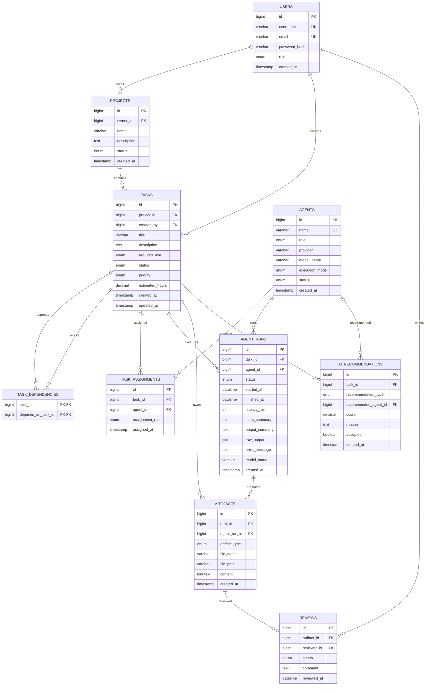

# AgentOps ER Diagram

## Relationship notes

- `task_dependencies` is a self-referencing many-to-many relationship between tasks.
- `task_assignments` models multiple agents participating in one task.
- `agent_runs` is the execution history; `tasks.status` is the current task state.
- `artifacts.content` stores the generated Markdown/code text so the UI can display it without requiring an external file service.
- `ai_recommendations` preserves AI scoring and the human acceptance decision for auditability.
